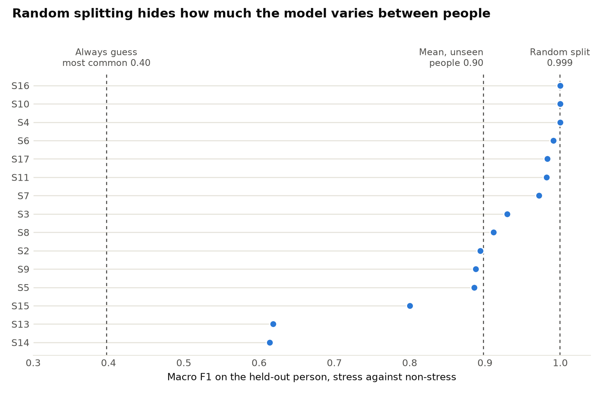

# Detecting stress in people the model has never met

Can a wearable tell when someone is stressed? The honest test is whether it works on a new person, so that is what this project measures. I use [WESAD](https://ubi29.informatik.uni-siegen.de/usi/data_wesad.html), a public dataset of 15 people wearing chest and wrist sensors through a lab stress protocol.

An earlier version of this repository was much weaker. It reported 57.8% accuracy on 61 samples without a baseline, and windows from one person could land in both training and test sets. I have replaced it with this version, which uses all 15 people and holds each one out in turn.



## What I found

Splitting the data at random makes the problem look solved, with a macro F1 of 0.999. Holding out whole people brings that down to about 0.90, and the score for one person can be as low as 0.61. The model has already seen the person in a random split, so most of the gap is presumably it recognising individuals.

| Stress against non-stress | Macro F1 | 95% CI across people | Accuracy |
|---|---:|---:|---:|
| Random forest, random split, flawed | 0.999 | | 0.999 |
| Random forest, unseen people | 0.898 | 0.832 to 0.953 | 0.914 |
| XGBoost, unseen people | 0.875 | 0.795 to 0.941 | 0.897 |
| Logistic regression, unseen people | 0.841 | 0.753 to 0.911 | 0.867 |
| Always guess the most common class | 0.397 | 0.395 to 0.399 | 0.659 |

Separating baseline from stress and amusement is harder, because amusement looks a lot like rest. The random forest labelled 155 of 317 amusement windows as baseline.

| Baseline, stress and amusement | Macro F1 | 95% CI across people | Accuracy |
|---|---:|---:|---:|
| Random forest, random split, flawed | 0.998 | | 0.999 |
| XGBoost, unseen people | 0.675 | 0.600 to 0.752 | 0.767 |
| Logistic regression, unseen people | 0.668 | 0.577 to 0.754 | 0.731 |
| Random forest, unseen people | 0.650 | 0.571 to 0.729 | 0.748 |
| Random forest, unseen people, calibrated | 0.758 | 0.656 to 0.853 | 0.861 |
| Always guess the most common class | 0.217 | 0.216 to 0.218 | 0.482 |

The [WESAD paper](https://www.eti.uni-siegen.de/ubicomp/papers/ubi_icmi2018.pdf) reports accuracy of up to 93% for the first task and up to 80% for the second. My numbers sit a little below that without calibration, and the features and windows differ, so this is a rough comparison.

### Is it just noticing that people are moving?

The stress condition involves standing up and giving a talk, so I wondered whether the model was simply picking up on that. Movement sensors alone reach a macro F1 of 0.716, which is well above chance. Taking them away barely changes anything, though, as XGBoost falls from 0.875 to 0.867 and the paired difference across people has a 95% CI of minus 0.018 to 0.036.

That is less reassuring than it sounds. Standing and speaking also raise your heart rate, and mean heart rate here is 98.5 bpm during stress against 72.9 at baseline. Removing the accelerometer can't remove that, so I can't claim the model is reading stress rather than the demands of the task.

### Does a short resting recording help?

Perhaps. I tried expressing each person's features relative to their first five minutes of rest, as a device could do on first wearing. Those five minutes are never scored in any setting. For the three class task the mean gain is 0.108, but the 95% CI runs from minus 0.013 to 0.231, so I wouldn't lean on it. For stress against non-stress there is no clear gain.

It also doesn't help everyone. S13 and S14 go from about 0.62 to 0.99 and 0.89, while S2 drops from 0.89 to 0.40. I haven't yet got to the bottom of why.

## What this can't tell you

- These are 15 people in one lab study, so it says little about stress in daily life.
- Labels come from the protocol rather than from how people felt. The notes for S6 say the talk wasn't really stressful because of many recent interviews, and the model still scored 0.99 for that person.
- I report the best of three models in the text above, which flatters it slightly. The tables show all three.
- Windows overlap, so the confidence intervals resample people rather than windows. With 15 people they are wide, and they should be.

## How it works

- Each window is 60 seconds with a 15 second step, and sits wholly inside one condition.
- Every feature has a name and comes from ECG, wrist pulse, skin conductance, temperature, respiration, EMG or acceleration.
- Models use fixed settings with no tuning, so held-out people are never used to choose anything.
- Imputation and scaling are fitted on training people only.

## Run it

The data is not included. Please get it from the [WESAD page](https://ubi29.informatik.uni-siegen.de/usi/data_wesad.html) and follow its terms. WESAD ships as pickle files, which can run code when opened, so the loader only allows the NumPy objects these files need.

```bash
pip install -e ".[dev]"
pytest
python -m wesad_stress.features --data /path/to/WESAD --out results/features.csv
python -m wesad_stress.evaluate
python -m wesad_stress.report
```

Every number here is in [results](results). The features themselves stay out of the repository, as they are derived from the data.

## Credit

Schmidt P, Reiss A, Duerichen R, Marberger C and Van Laerhoven K. Introducing WESAD, a Multimodal Dataset for Wearable Stress and Affect Detection. ICMI 2018.
